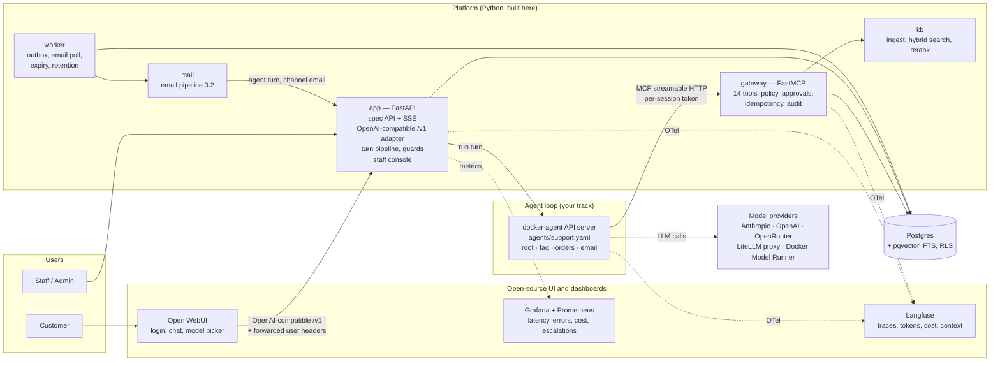
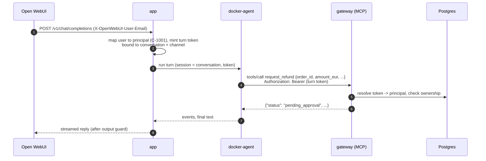
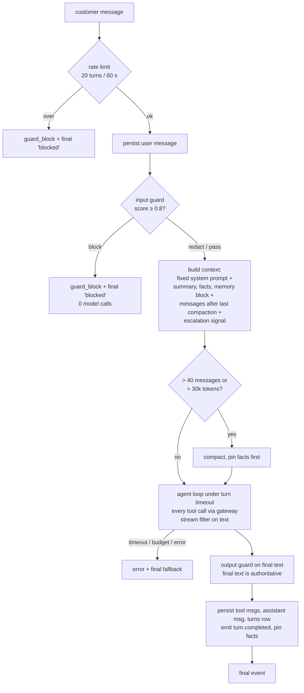
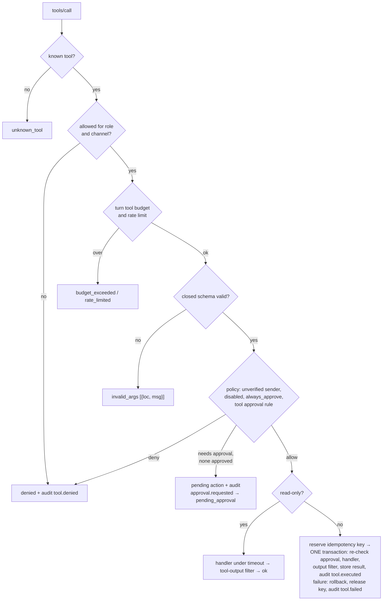
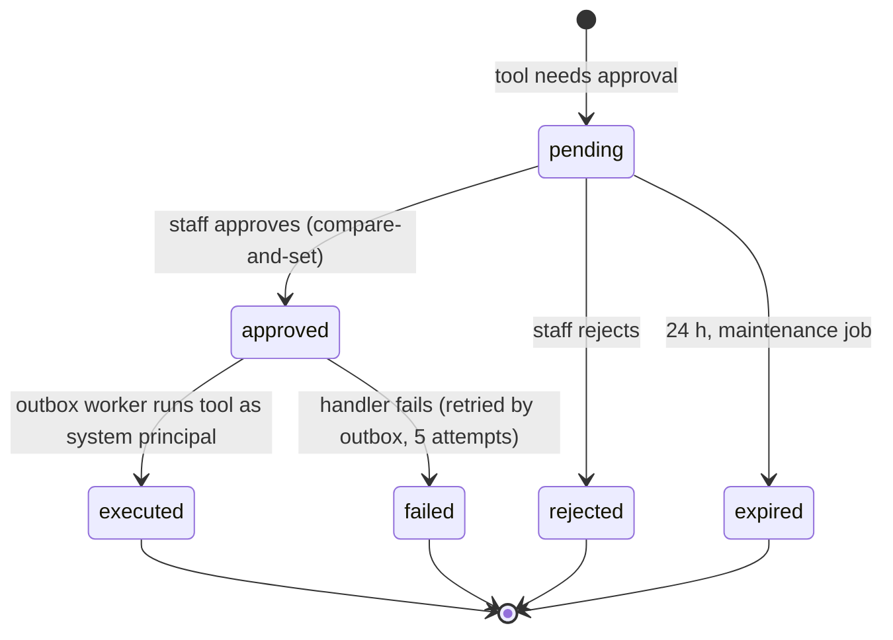
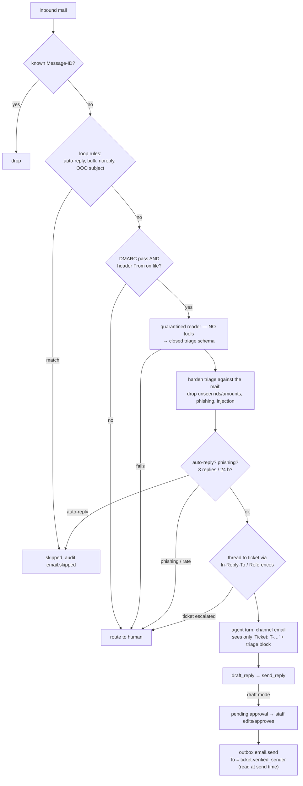
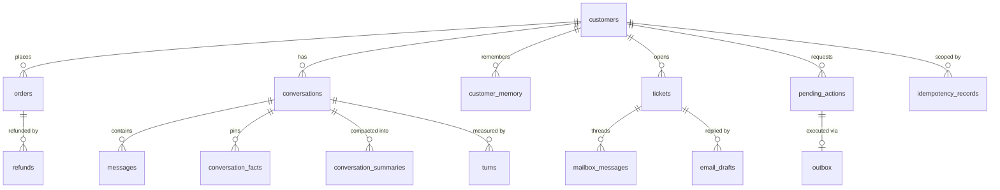

# Architecture

Spec: [`requirements-and-benchmarks.md`](../requirements-and-benchmarks.md). Requirement status:
[`requirements-map.md`](requirements-map.md). Progress: [`../PROGRESS.md`](../PROGRESS.md).

## 1. Principles

1. **The tool layer is the security boundary, not the prompt.** Identity, ownership checks, approvals,
   idempotency and limits live in the gateway. A model or agent-YAML mistake cannot break them (spec 6, R-4.6.1).
2. **docker-agent is only the agent loop.** It is one of three interchangeable loops behind one interface:
   `docker-agent`, `scripted` (no-model baseline, spec 15.2) and `fake` (scripted tool calls, for the red team).
   Server, tools, policy and evals stay the same when the loop changes (B-16).
3. **The database is the source of truth.** Any docker-agent session is a cache that can be rebuilt from the
   summary, pinned facts and history (R-4.3.1).
4. **Offline by default.** No model call unless `CCARE_LIVE=1`; every live call goes through the spend ledger.
5. **Open-source for the edges.** Chat UI, login and dashboards are off-the-shelf; we only build what the spec
   makes ours.

## 2. Containers

| Container | Owns | Spec |
|---|---|---|
| `app` | Auth, routes, SSE, turn pipeline, input/output guards, budgets, persistence, staff console, OpenAI-compatible adapter for Open WebUI | 3.1, 7.2-7.5, 9 |
| `gateway` | The 14 tools, closed schemas, execution order, policy file, approvals, idempotency, tool-output filter, audit | 6, 7.1, 7.7 |
| `worker` | Outbox (approved actions, email send), approval expiry, retention, inbox poll | 3.3, 6.7, 7.8 |
| `kb` | Heading-path chunks, embeddings, BM25 + vector, RRF, rerank, citations | B-04 |
| `mail` | Dedupe, loop rules, sender trust, quarantined reader, triage hardening, threading | 3.2 |
| docker-agent | Model calls, routing between sub-agents | (any framework) |
| Postgres | All state; pgvector for KB and history; row-level security per customer | 8, B-19 |

Code layout: everything Python is under `src/ccare/` (`app`, `gateway`, `kb`, `mail`, `db`, `seed`). The email
package is `mail`, not `email`, so it does not shadow the standard library.

## 3. Identity: how a tool call knows the customer

The model never names the customer (B-06, B-20). The bearer token of the HTTP request that carries the MCP call
decides.

**Open point (Phase 0 spike):** how docker-agent attaches a per-session token to a remote MCP toolset. The
gateway already reads `Authorization: Bearer` and logs `X-Conversation-Id`, `X-Channel` and `Mcp-Session-Id`
(`whoami` tool). The spike decides between: per-session headers from docker-agent, an environment-expanded header
per session, or one docker-agent session per conversation started with its own token. The decision goes here.

## 4. Turn pipeline (spec 3.1, order is normative)

## 5. Gateway execution order (spec 6.5)

## 6. Approval flow (spec 3.3)

A customer deciding gets 403; a second decision gets 409; two concurrent decisions: exactly one wins.

## 7. Email pipeline (spec 3.2)

## 8. Data model (core)

Full column list: spec section 8 and [`src/ccare/db/models.py`](../src/ccare/db/models.py). Extra tables not in
the spec: `staff`, `demo_tokens` (seed principals of 10.1) and `spend_ledger` (B-12). Money is integer cents.

## 9. Models and providers

| Task | Where the call happens | Default model (live) | Offline |
|---|---|---|---|
| Chat / email agent turns | docker-agent (`agents/support.yaml`) | cheap model for faq, stronger for refunds and email | `scripted` loop |
| Email reader (quarantined, no tools) | `mail`, via LiteLLM SDK | small model | rule-based reader (3.2) |
| LLM judge | `evals`, via LiteLLM SDK | small model, one shared id | rule judge, criteria `skipped` |
| Compaction summary | `app`, via LiteLLM SDK | small model | deterministic summary |

Providers reachable from both docker-agent and LiteLLM: Anthropic, OpenAI, OpenRouter (OpenAI-compatible
`base_url`), a LiteLLM proxy (OpenAI-compatible), Docker Model Runner. Every model id needs a row in the price
table (input, output, cache read, cache write); an unknown model raises (B-22).

## 10. Deployment path

| Stage | Where | Notes |
|---|---|---|
| Local | `deploy/compose/compose.yaml` | Phase 0: Postgres. Grows to the full stack above. |
| Kubernetes | kind / k3d, `deploy/k8s/` | Stateless pods; turn lock, rate limits and SSE buffers move to Redis first (R-4.1.2). HPA, then KEDA on outbox depth. |
| AWS ECS Fargate | `deploy/terraform/` | Smallest tasks, no NAT, SSM for secrets, budget alert, destroy after each session. |
| AWS EKS | `deploy/terraform/` | Same manifests as kind; Spot or Fargate profiles; destroyed the same day. |
